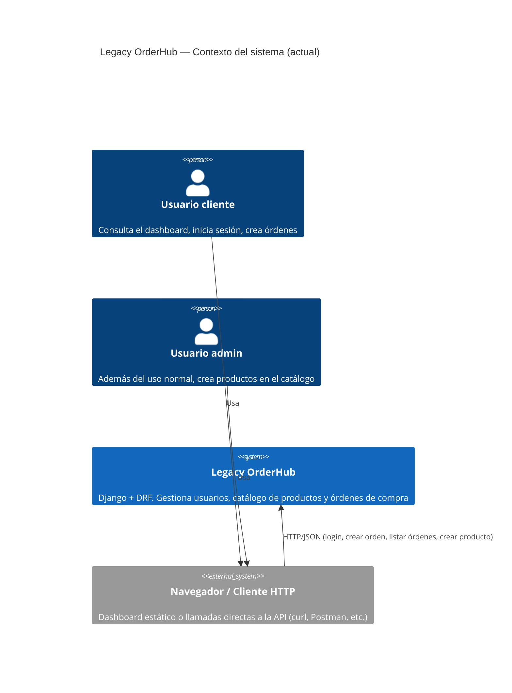
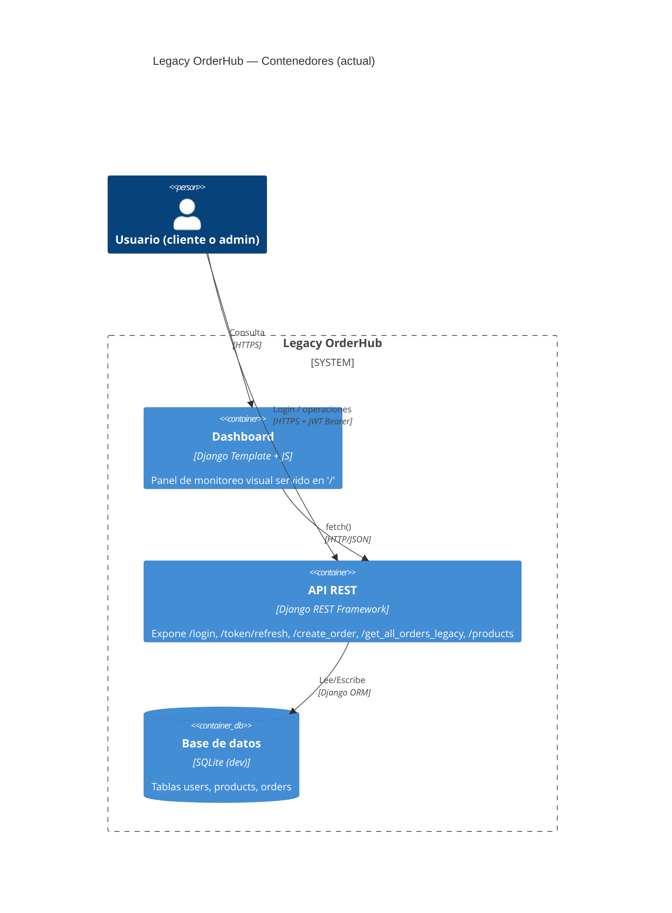
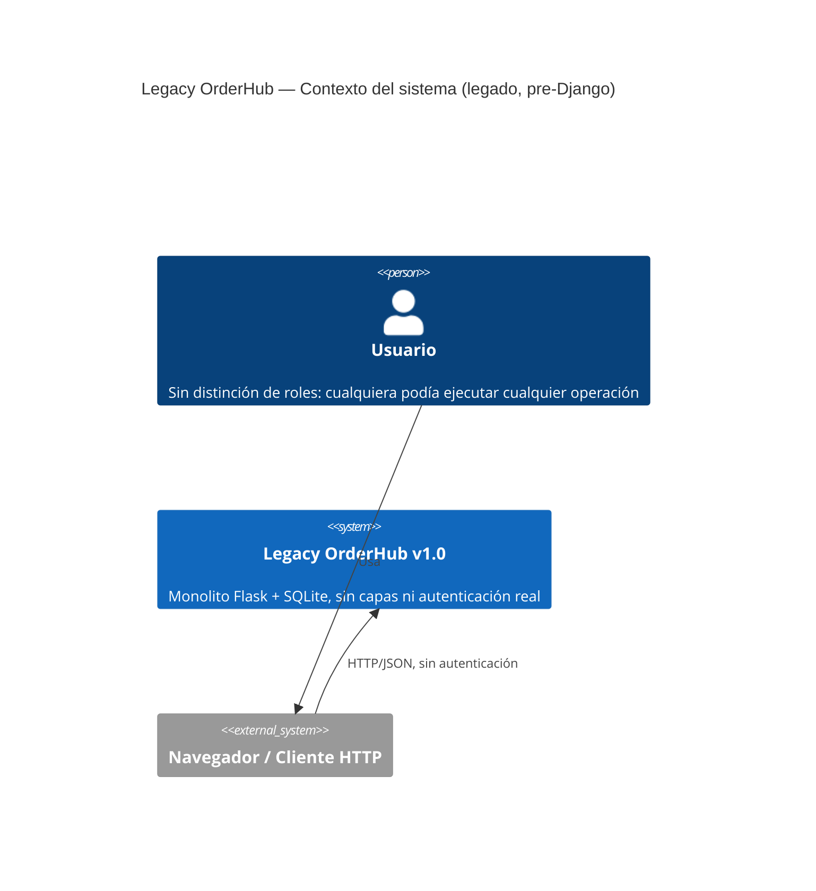
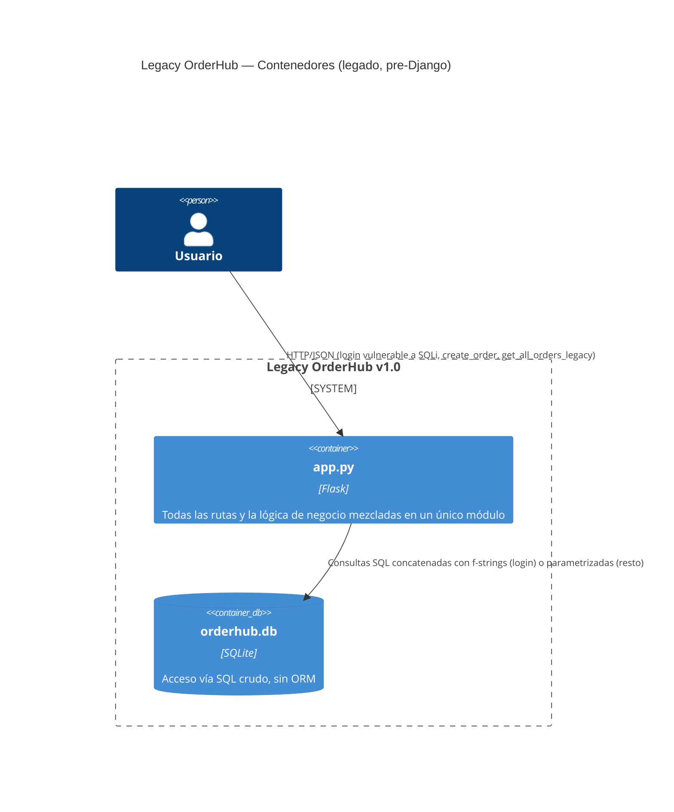

# Arquitectura del Sistema (C4) — Legacy OrderHub

> Diagramas C4 obtenidos por ingeniería inversa asistida por IA: Nivel 1 (Contexto) y Nivel 2 (Contenedores), tanto del sistema legado (Flask, previo a esta entrega) como del estado actual (Django + DRF, arquitectura hexagonal). Se actualiza en cada cambio arquitectónico relevante — ver también [`HEXAGONAL_ARCHITECTURE.md`](HEXAGONAL_ARCHITECTURE.md) para el detalle de capas y [`TECHNICAL_DEBT_LOG.md`](TECHNICAL_DEBT_LOG.md) para la deuda técnica identificada.

---

## Estado actual (Django + DRF)

### C4 Nivel 1 — Contexto del sistema

### C4 Nivel 2 — Contenedores

Cada uno de los tres contextos delimitados (`apps/users`, `apps/catalog`, `apps/orders`) implementa internamente arquitectura hexagonal (dominio → aplicación → infraestructura → adaptador HTTP) — ver [`HEXAGONAL_ARCHITECTURE.md`](HEXAGONAL_ARCHITECTURE.md) para el desglose de capas.

---

## Sistema legado (Flask, previo a la migración)

Reconstruido a partir del historial de git (`git show 4c79d1d:app.py`), representa el estado del sistema antes de cualquier refactorización de esta asignatura.

### C4 Nivel 1 — Contexto del sistema (legado)

### C4 Nivel 2 — Contenedores (legado)

**Hallazgos clave de esta reconstrucción** (detalle completo en `TECHNICAL_DEBT_LOG.md`): inyección SQL real en `/login` vía f-string, contraseñas en texto plano, secretos hardcoded en `config.py`, y dos endpoints (`/create_order`, `/get_all_orders_legacy`) que nunca se registraban en tiempo de ejecución por estar declarados después de la llamada bloqueante a `app.run()`.
